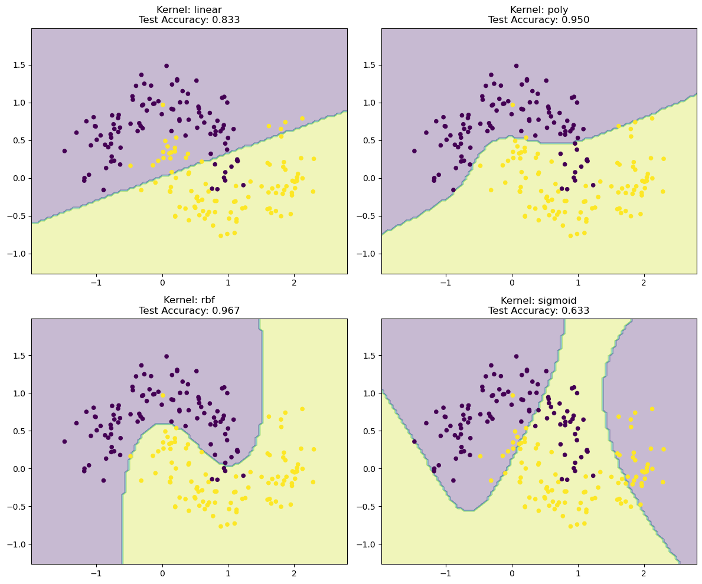
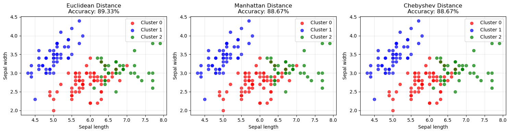

# Machine Learning Fundamentals

Core machine learning algorithms, some implemented from scratch in NumPy and some explored with scikit-learn. Each notebook pairs an algorithm with an experiment that shows how it behaves: learning rate, regularization, kernel choice, distance metric, model size.

| # | Topic | Notebook | What it shows |
|---|---|---|---|
| 1 | **Perceptron (from scratch)** | [`01_perceptron/perceptron_from_scratch.ipynb`](01_perceptron/perceptron_from_scratch.ipynb) | Batch and sequential update rules in NumPy, compared across learning rates from 0.001 to 100. A small learning rate takes 266 batch iterations to converge; 0.1 takes 11. Large learning rates make the sequential version less stable. |
| 2 | Perceptron (scikit-learn) | [`01_perceptron/sklearn_perceptron_separable.ipynb`](01_perceptron/sklearn_perceptron_separable.ipynb) | Decision boundary on near-separable data (100% test accuracy). |
| 3 | Perceptron on imbalanced data | [`01_perceptron/sklearn_perceptron_imbalanced.ipynb`](01_perceptron/sklearn_perceptron_imbalanced.ipynb) | 80/20 class imbalance with label noise. Accuracy is **0.80** but minority-class recall is only **0.50**, which shows why precision, recall and F1 matter. |
| 4 | **SVM: regularization and kernels** | [`02_svm/svm_regularization_and_kernels.ipynb`](02_svm/svm_regularization_and_kernels.ipynb) | On the moons data, larger C fits tighter boundaries and uses fewer support vectors. Kernel comparison: RBF **0.967**, polynomial 0.950, linear 0.833, sigmoid 0.633. |
| 5 | Neural network (MLP) | [`03_neural_network/mlp_digits.ipynb`](03_neural_network/mlp_digits.ipynb) | Sweep of hidden-layer size on handwritten digits. 100 hidden units reach **98.3%** test accuracy; adding more units does not help. |
| 6 | **K-means (from scratch)** | [`04_kmeans/kmeans_from_scratch.ipynb`](04_kmeans/kmeans_from_scratch.ipynb) | NumPy K-means with Euclidean, Manhattan and Chebyshev distance on Iris: 89.3% / 88.7% / 88.7% cluster accuracy. |
| 7 | PCA | [`05_pca/pca_iris.ipynb`](05_pca/pca_iris.ipynb) | Iris reduced from 4 to 2 dimensions keeps **97.8%** of the variance; includes component loadings. |





## Run it

```bash
pip install numpy scikit-learn matplotlib jupyter
jupyter notebook
```

All datasets are either generated in the notebook (`make_blobs`, `make_classification`, `make_moons`) or built into scikit-learn (Iris, Digits).
